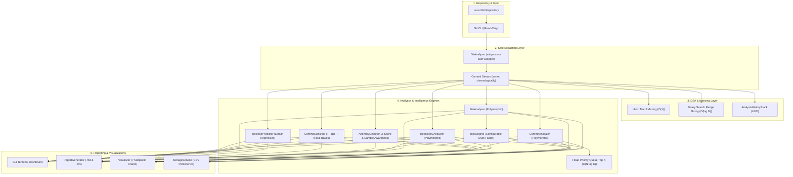

# DevPulse — Software Release Intelligence & Codebase Risk Analyzer

[](https://www.python.org/downloads/)
[](https://opensource.org/licenses/MIT)
[](https://docs.pytest.org/)
[](https://peps.python.org/pep-0008/)

**DevPulse** is a local-first software engineering intelligence and release-risk analysis tool built for engineering leads, release managers, and developers. It mines local Git history to uncover code churn velocity, file hotspot volatility, statistical commit anomalies, commit intent categories, and forward release change-volume estimates.

> **Zero Cloud/LLM Dependency:** DevPulse runs 100% locally on your machine. It makes zero external API calls to OpenAI, Anthropic, or cloud services, guaranteeing that your proprietary source code never leaves your workstation or CI runner.

---

## Table of Contents

- [Problem Statement](#problem-statement)
- [Why DevPulse?](#why-devpulse)
- [System Architecture](#system-architecture)
- [Project Structure](#project-structure)
- [Installation](#installation)
- [Quickstart & CLI Usage](#quickstart--cli-usage)
- [Sample Terminal Output](#sample-terminal-output)
- [Object-Oriented Design (OOP)](#object-oriented-design-oop)
- [Data Structures & Algorithms (DSA)](#data-structures--algorithms-dsa)
- [Data Analytics & Heuristics](#data-analytics--heuristics)
- [Machine Learning Components](#machine-learning-components)
- [Release Risk Scoring Engine](#release-risk-scoring-engine)
- [Statistical Anomaly Detection](#statistical-anomaly-detection)
- [Automated Testing](#automated-testing)
- [Security & Git Safety](#security--git-safety)
- [Limitations & Privacy](#limitations--privacy)
- [Resume Description](#resume-description)
- [Technical Interview Q&A](#technical-interview-qa)

---

## Problem Statement

Modern software releases often fail or introduce severe regressions not because developers lack skill, but because changes are concentrated in volatile, high-churn files that lack proportional review and testing. Engineering teams frequently suffer from:
1. **Blind Release Risks:** No visibility into which modified files are disproportionately volatile or touched by multiple authors right before release.
2. **Commit Noise:** Inability to quickly categorize hundreds of commit messages into functional engineering intents (Features vs. Bug Fixes vs. Refactors).
3. **Unusual Change Bursts:** Silent merges of outsized changes or runaway diffs that evade regular code reviews.
4. **Unpredictable Change Velocity:** Uncertainty regarding how much code volume will shift in upcoming release cycles.

---

## Why DevPulse?

DevPulse addresses these challenges without requiring expensive SaaS tools or sending intellectual property to third-party AI APIs.

* **Heuristic Risk Identification:** Pinpoints codebase hotspots using explainable factors (churn, author dispersion, modification frequency, and recency).
* **Safe & Non-Destructive:** Operates strictly in read-only mode via safe standard-library subprocess calls.
* **Deterministic DSA Efficiency:** Employs Hash Maps ($O(1)$), Priority Queue Heaps ($O(N \log K)$), and Binary Search ($O(\log N)$) to handle repositories with thousands of commits smoothly.
* **Pragmatic ML:** Uses TF-IDF + Multinomial Naive Bayes for commit intent categorization and Ordinary Least Squares Linear Regression for chronological velocity forecasting.

---

## System Architecture



---

## Project Structure

```
devpulse/
├── main.py                     # CLI entry point and subcommands
├── requirements.txt            # Pinned dependencies
├── pytest.ini                  # Pytest configuration
├── .gitignore                  # Git ignore rules
├── README.md                   # Complete architectural guide
├── LICENSE                     # MIT License
│
├── config/
│   ├── __init__.py
│   └── settings.py             # Configurable thresholds, weights, and parameters
│
├── models/
│   ├── __init__.py
│   ├── repository.py           # Repository metadata and health model
│   ├── commit.py               # Commit model with validation, date comparison & encapsulation
│   ├── file_change.py          # Discrete file modification & churn model
│   ├── developer.py            # Contributor activity metrics (non-evaluative)
│   ├── risk.py                 # RiskResult and ReleaseRisk dataclasses
│   └── exceptions.py           # Custom exception hierarchy
│
├── services/
│   ├── __init__.py
│   ├── analyzer.py             # Base Analyzer abstract class (OOP contract)
│   ├── git_analyzer.py         # Read-only Git subprocess extractor
│   ├── repository_analyzer.py  # Repository-level polymorphic analyzer
│   ├── commit_analyzer.py      # Commit dynamics polymorphic analyzer
│   ├── file_analyzer.py        # File-level volatility polymorphic analyzer
│   ├── analytics.py            # pandas & NumPy churn and health metrics
│   ├── risk_engine.py          # Multi-factor codebase risk scoring
│   ├── anomaly_detector.py     # Statistical Z-score outlier detection
│   ├── commit_classifier.py    # TF-IDF + MultinomialNB commit classifier
│   ├── release_predictor.py    # Scikit-learn LinearRegression churn forecaster
│   ├── dsa_utils.py            # Hash Map, Heap, Binary Search, and LIFO Stack
│   ├── report_generator.py     # Markdown and summary CSV generator
│   ├── storage.py              # Validated CSV persistence service
│   └── visualizer.py           # 7 Headless Matplotlib visualizations
│
├── utils/
│   ├── __init__.py
│   ├── validators.py           # Paths, hashes, and non-negative validators
│   ├── dates.py                # ISO 8601 parsing and date calculations
│   └── formatters.py           # Terminal headers, diffs, and formatting
│
├── reports/                    # Generated Markdown and CSV reports
│   └── .gitkeep
├── charts/                     # Generated PNG charts
│   └── .gitkeep
└── tests/
    ├── __init__.py
    ├── conftest.py             # Fixtures and deterministic git repository
    ├── test_models.py          # Model encapsulation and comparison tests
    ├── test_git_analyzer.py    # Git extraction and security checks
    ├── test_dsa.py             # Hash map, Heap, Binary Search, Stack tests
    ├── test_analytics.py       # Churn, volatility, health score tests
    ├── test_risk_engine.py     # Risk calculations and threshold tests
    ├── test_anomaly_detector.py# Z-score and zero std-dev tests
    ├── test_classifier.py      # TF-IDF + Naive Bayes tests
    ├── test_predictor.py       # Linear regression trend tests
    ├── test_storage.py         # CSV persistence roundtrip tests
    └── test_report_generator.py# Report and chart generation tests
```

---

## Installation

### Prerequisites
- Python 3.10 or higher
- Git 2.20+ installed on your system PATH (`git --version`)

### Windows PowerShell Setup
```powershell
# Clone or navigate to repository
cd DevPulse

# Create virtual environment
python -m venv .venv

# Activate virtual environment
.venv\Scripts\Activate.ps1

# Install dependencies
pip install -r requirements.txt
```

### Linux / macOS Setup
```bash
# Navigate to repository
cd DevPulse

# Create virtual environment
python3 -m venv .venv

# Activate virtual environment
source .venv/bin/activate

# Install dependencies
pip install -r requirements.txt
```

---

## Quickstart & CLI Usage

DevPulse provides a dedicated, non-interactive command-line interface powered by `argparse`:

### 1. Complete Repository Intelligence Analysis
```bash
# Analyze full repository history and generate reports + charts
python main.py analyze .

# Analyze specific commit depth or branch
python main.py analyze . --commits 200 --branch main

# Custom output directories
python main.py analyze . --output-dir custom_reports --charts-dir custom_charts
```

### 2. Inspect Top Risky Hotspot Files
```bash
python main.py risky-files . --top-k 5 --threshold 50.0
```

### 3. Review Chronological Commits & Code Churn
```bash
python main.py commits . --limit 25 --author "Alice"
```

### 4. Review Contributor Activity Distribution
```bash
python main.py developers .
```

### 5. Predict Next-Release Code Change Volume
```bash
python main.py predict . --period W
```

### 6. Classify Commit Intent Messages
```bash
# Classify recent commits in repository
python main.py classify . --limit 50

# Test a single message string
python main.py classify --message "fix: resolve jwt token expiration race condition"
```

### 7. Export Standalone Reports & Visualizations
```bash
# Generate Markdown & CSV reports only
python main.py report .

# Generate all 7 Matplotlib charts only
python main.py charts .
```

---

## Sample Terminal Output

```
================================================================
DEVPULSE
SOFTWARE RELEASE INTELLIGENCE
=============================

Repository:
C:\Projects\my-project

Branch:
main

Commits analyzed:
184

Files analyzed:
97

Developers:
4

---

## REPOSITORY HEALTH

Health Score: 78/100

Release Risk: MEDIUM

---

## TOP RISKY FILES

1. src/services/payment.py              91
2. src/auth/service.py                  84
3. src/order/controller.py              79
4. src/database/repository.py          73
5. src/api/routes.py                    68

---

## UNUSUAL COMMITS

3 unusual commit(s) detected.
  * [a1b2c3d]: Change volume (+2,481/-931) is significantly above historical pattern.

---

## COMMIT CLASSIFICATION

Feature         61
Bug Fix         43
Refactor        31
Testing         18
Documentation   12
Other           19

---

## RELEASE FORECAST

Predicted next-period change volume:
~ 927 lines

---

## RECOMMENDED REVIEW AREAS

1. src/services/payment.py
2. src/auth/service.py
3. src/order/controller.py

================================================================
[+] Generated Markdown report : reports\repository_report.md
[+] Generated Summary CSV     : reports\repository_summary.csv
[+] Persisted datasets to     : reports
[+] Rendered 7 charts to      : charts
```

---

## Object-Oriented Design (OOP)

DevPulse uses core OOP principles to maintain a clean domain boundary:

### 1. Encapsulation
* `Commit` guards its core attributes (`_commit_hash`, `_commit_date`, `_author`) as private/protected fields.
* Input validation is enforced on initialization (e.g. SHA-1 format, non-negative line counts).
* Controlled setters allow downstream analyzers to attach enrichment properties (`classification`, `risk_score`) while protecting raw git metadata.
* Domain models provide `to_dict()` and `from_dict()` serialization patterns.

### 2. Inheritance
A formal inheritance hierarchy defines the analyzer engine contract:
```
           Analyzer (ABC)
                  |
    +-------------+-------------+
    |                           |
RepositoryAnalyzer       CommitAnalyzer       FileAnalyzer
```

### 3. Polymorphism
Every subclass implements the identical `analyze(target: Any) -> Dict[str, Any]` interface signature while executing specialized algorithms:
* `RepositoryAnalyzer`: Synthesizes repository cadence, health scores, and commit spans.
* `CommitAnalyzer`: Computes code churn metrics, temporal distributions, and size statistics.
* `FileAnalyzer`: Aggregates file-level modifications and calculates volatility hotspots.

In `main.py`, the orchestration engine runs polymorphic analyzers interchangeably without coupling to their internal implementations.

---

## Data Structures & Algorithms (DSA)

DevPulse deliberately selects data structures to optimize runtime complexity and memory consumption:

| Data Structure / Algorithm | Location | Purpose | Time Complexity | Space Complexity |
| :--- | :--- | :--- | :--- | :--- |
| **Hash Maps** (`dict`) | `services/dsa_utils.py` | Hash lookup for `commit_hash -> Commit`, `file_path -> FileStats`, and `author_email -> Developer`. | Lookups: **$O(1)$** average. | **$O(N)$** |
| **Heap Priority Queue** (`heapq.nlargest`) | `services/dsa_utils.py` | Extracting Top-$K$ risky files and Top-$K$ modified files without sorting the entire $N$-sized dataset. | Selection: **$O(N \log K)$** | **$O(K)$** auxiliary |
| **Binary Search** (`bisect`) | `services/dsa_utils.py` | Slicing chronologically sorted commits between two dates `[start_date, end_date]`. | Search: **$O(\log N + M)$** | **$O(1)$** auxiliary |
| **LIFO Stack** (`AnalysisHistoryStack`) | `services/dsa_utils.py` | Tracking filter and analysis states to provide clean `undo_last_filter()` operations. | Push/Pop: **$O(1)$** | **$O(S)$** |

### Why `heapq.nlargest` instead of sorting?
In large repositories containing 20,000+ files, sorting the full array to retrieve the top 5 hotspots takes $O(N \log N)$ time and requires large memory allocations. `heapq.nlargest` maintains an in-memory min-heap of size $K=5$, processing each element in $O(\log K)$, achieving $O(N \log K)$ runtime and using negligible auxiliary memory.

### Why Binary Search on Commits?
Git commits are chronologically ordered. Finding commits within an arbitrary date range via linear scan requires evaluating every commit ($O(N)$). Using `bisect_left` and `bisect_right` locates the boundary indices in $O(\log N)$ steps, slicing only the matching $M$ elements in $O(M)$ time.

---

## Data Analytics & Heuristics

DevPulse uses **pandas** and **NumPy** for reliable numerical processing:
* **Code Churn:** Computes additions, deletions, total churn, mean, median (robust to skew), and peak commit events.
* **Temporal Distribution:** Groups commits by calendar day of week and month-year periods to highlight developer activity spikes.
* **File Volatility Heuristic:**
  $$\text{Volatility} = w_{\text{freq}} \cdot \text{FreqRatio} + w_{\text{churn}} \cdot \ln(1 + \text{Churn}) + w_{\text{auth}} \cdot (\text{Authors} - 1) + w_{\text{rec}} \cdot \text{Recency}$$
  *Note:* Volatility is an empirical engineering heuristic designed to highlight code churn hotspots, not a scientifically validated bug predictor.

---

## Machine Learning Components

DevPulse applies machine learning selectively where classical algorithms are insufficient:

### 1. Commit Intent Classification (TF-IDF + Multinomial Naive Bayes)
* **Problem:** Categorize free-form developer commit messages into standard intent classes: `Feature`, `Bug Fix`, `Refactor`, `Performance`, `Testing`, `Documentation`, `Configuration`, and `Other`.
* **Technique:** Unigram and bigram TF-IDF vectorization with English stop-word filtering followed by a `MultinomialNB(alpha=0.5)` classifier.
* **Confidence Guardrail:** A minimum probability threshold ($0.28$) is enforced. Ambiguous or low-confidence messages fall back to `Other`.
* **Limitation:** The model operates on token frequencies and conventional prefixes. It does not perform semantic reasoning on diff content.

### 2. Release Change-Volume Forecast (Linear Regression)
* **Problem:** Estimate expected code change volume (churn) for upcoming release intervals.
* **Technique:** Ordinary Least Squares (OLS) Linear Regression modeling historical churn across chronological periods (weekly or monthly intervals).
* **Outputs:** Predicted change volume (lines), slope coefficient, intercept, and historical Mean Absolute Error (MAE).
* **Guardrail:** Requires at least 3 historical time intervals. Raises `InsufficientDataError` on sparse repositories rather than fabricating fake predictions.

---

## Release Risk Scoring Engine

The central feature of DevPulse evaluates risk on a **0 to 100** continuous scale:

```
 0 ------------- 30 ------------- 60 ------------- 80 ------------- 100
 [     LOW     ] [   MEDIUM    ] [    HIGH     ] [   CRITICAL    ]
```

### Risk Factors Evaluated
1. **Modification Frequency:** Proportion of repository commits that touched the file.
2. **Accumulated Churn:** Absolute volume of lines added and removed.
3. **Contributor Ownership Dispersion:** Single-developer code vs. multi-author coordination overhead.
4. **Activity Recency:** Modifications made within the past 7 to 30 days receive higher risk weighting before release.
5. **Historical Volatility:** Recurrent hotspot behavior across historical releases.

Every evaluated file includes explainable reasons and recommended actions (e.g., *"Immediate peer review required; execute targeted unit and integration regression suites"*).

---

## Statistical Anomaly Detection

DevPulse identifies unusual activity using statistical $Z$-scores:
$$Z = \frac{x - \mu}{\sigma}$$

* **Normal Commit:** $+42 / -18$
* **Anomalous Commit:** $+2,481 / -931$ $(Z \ge 2.5)$
* **Defensive Edge Case Handling:**
  * Handles $\sigma = 0$ (all commits identical) without raising `ZeroDivisionError`.
  * Handles small sample sizes ($N < 10$) by adjusting effective thresholds to respect finite-sample maximum possible $Z$-scores ($Z_{\max} \le \frac{N-1}{\sqrt{N}}$).

---

## Automated Testing

The project includes **62 comprehensive unit and integration tests** built with pytest, requiring zero internet access:

```bash
python -m pytest -v
```

### Test Coverage Highlights
* **Domain Models (`test_models.py`):** Encapsulation, validation, date comparison operators, serialization.
* **Data Structures (`test_dsa.py`):** $O(1)$ Hash Map lookups, $O(N \log K)$ Heap extraction, $O(\log N)$ Binary Search, LIFO Stack undo.
* **Git Extraction (`test_git_analyzer.py`):** Real temporary Git repositories, read-only enforcement, branch detection, empty repository handling.
* **Analytics & Polymorphism (`test_analytics.py`):** Churn metrics, volatility, health score deductions, polymorphic analyzer interfaces.
* **Risk Engine (`test_risk_engine.py`):** High-risk and low-risk classification, boundary clamping, explainable reasons.
* **Anomaly Detector (`test_anomaly_detector.py`):** Outlier detection, zero standard deviation, small sample handling.
* **Classifier & Predictor (`test_classifier.py`, `test_predictor.py`):** TF-IDF classification, insufficient data exceptions.
* **Persistence & Reports (`test_storage.py`, `test_report_generator.py`):** CSV roundtrips, malformed CSV error handling, Markdown report rendering, Matplotlib chart creation.

---

## Security & Git Safety

* **Strictly Read-Only:** DevPulse forbids mutating Git operations (`commit`, `push`, `checkout`, `reset`, `merge`, `rebase`, `pull`, `clean`, `rm`).
* **No `shell=True`:** Subprocess calls pass explicit argument lists, preventing shell injection vulnerabilities.
* **Local Data Privacy:** Source code is never uploaded, transmitted, or logged.
* **Untrusted Input Defense:** Treats repositories as untrusted data; never executes arbitrary code or scripts found within the repository.

---

## Limitations & Privacy

1. **Commit Message Quality:** The Naive Bayes classifier depends on meaningful commit messages. If a team writes single-character or opaque messages (`"wip"`, `"."`), predictions will default to `Other`.
2. **Linear Trend Simplicity:** Linear regression assumes chronological velocity trends. It cannot anticipate team reorganization, holiday pauses, or sudden scope alterations.
3. **No Code Surveillance:** Developer activity metrics measure distribution of changes to prevent single points of failure. They are explicitly **not** designed for employee surveillance or performance ranking.

---

## Resume Description

* **DevPulse — Software Release Intelligence & Codebase Risk Analyzer (Python, Git, scikit-learn, pandas, Matplotlib)**
  * Architected a local-first software engineering analytics tool that mines Git history to evaluate code churn velocity, file hotspot volatility, and release risk scores (0–100).
  * Engineered high-performance data processing pipelines utilizing Hash Maps ($O(1)$), Heap Priority Queues ($O(N \log K)$ via `heapq`), and Binary Search date slicing ($O(\log N)$ via `bisect`) across thousands of commits.
  * Implemented an explainable ML pipeline combining TF-IDF + Multinomial Naive Bayes for commit intent categorization and Linear Regression for release code-change volume forecasting.
  * Authored a 62-test automated suite using pytest, temporary Git fixtures, and defensive statistical bounds (Z-score anomaly detection, zero standard deviation handling).

---

## Technical Interview Q&A

### 1. Why did you use a Hash Map instead of lists?
Hash maps (`dict`) provide $O(1)$ average time complexity for key-based lookups (`commit_hash -> Commit`, `file_path -> FileStats`, `author_email -> Developer`). In a repository with thousands of commits, searching a list linearly would require $O(N)$ for every file modification, resulting in an unscalable $O(N^2)$ analysis runtime.

### 2. Why use `heapq.nlargest` instead of sorting the whole dataset?
Sorting an array of $N$ files takes $O(N \log N)$ time. When the dashboard only displays the Top 5 or Top 10 risky files, maintaining a min-heap of size $K$ using `heapq.nlargest` runs in $O(N \log K)$ time and $O(K)$ auxiliary space. For large repositories ($N = 25,000$), $O(N \log K)$ is substantially faster and conserves memory.

### 3. How does Binary Search work on commit history?
Git commits have monotonic chronological timestamps. Because the commit sequence is strictly sorted, we use `bisect.bisect_left` and `bisect.bisect_right` on commit timestamps to find date-range boundaries in $O(\log N)$ steps rather than iterating through the entire commit history in $O(N)$.

### 4. How does the Risk Engine calculate the 0–100 score?
The score is a weighted multi-factor heuristic:
* Modification Frequency (25%)
* Accumulated Code Churn (30%)
* Contributor Ownership Dispersion (20%)
* Recency of Changes (15%)
* Historical Volatility (10%)
The score is bounded to $[0, 100]$ and mapped to qualitative tiers (`LOW`, `MEDIUM`, `HIGH`, `CRITICAL`), accompanied by explainable drivers and mitigation actions.

### 5. Why TF-IDF for commit classification?
Commit messages are short, domain-specific texts where certain tokens (e.g. `"fix"`, `"null"`, `"feat"`, `"refactor"`, `"docs"`) carry strong discriminative signal. Term Frequency-Inverse Document Frequency (TF-IDF) dampens ubiquitous words while amplifying high-information intent keywords.

### 6. Why Multinomial Naive Bayes?
Multinomial Naive Bayes is lightweight, trains in milliseconds on sparse token frequency vectors, handles multi-class problems naturally, and outputs calibrated class probabilities. If confidence falls below $0.28$, DevPulse conservatively defaults to `"Other"`.

### 7. Why Linear Regression for release predictions?
Release code change volume follows sprint-to-sprint delivery velocity. Ordinary Least Squares (OLS) Linear Regression establishes an interpretable baseline slope (lines added/removed per period) with clear parameters (coefficient, intercept, MAE) without overfitting sparse historical time series.

### 8. How do you prevent data leakage in release predictions?
The dataset is partitioned chronologically. Only historical intervals prior to the target period are used for fitting. We never shuffle time-series data or allow future commit timestamps to influence prior period aggregations.

### 9. What are the limitations of the prediction model?
Linear regression assumes linear velocity. Real development cycles involve sprint endings, holidays, and architectural pivots. DevPulse explicitly documents that forecasts represent indicative baselines rather than contractual guarantees.

### 10. How does the Git Analyzer operate safely?
It interfaces with Git through Python's standard library `subprocess.run` with discrete argument lists (`shell=False`). Mutating commands (`push`, `commit`, `checkout`, `reset`, `rm`) are explicitly blacklisted. The analyzer operates strictly in read-only mode.

### 11. How would you scale this application for enterprise mono-repos?
For repositories with millions of commits:
1. Implement shallow log parsing with `--since` filters or revision limits.
2. Stream git log numstat lines using generator iterators instead of loading full string logs into memory.
3. Cache intermediate commit summaries in SQLite or DuckDB for incremental updates on new commits.

### 12. How would you turn this into a CI/CD tool?
1. Wrap DevPulse in a Docker container or GitHub Action.
2. In PR pipelines, run `devpulse risky-files . --threshold 80.0` against the PR merge commit.
3. If high-risk hotspot files or outsized anomalies are detected, post a review comment on the PR and fail the build if risk exceeds a defined threshold.
